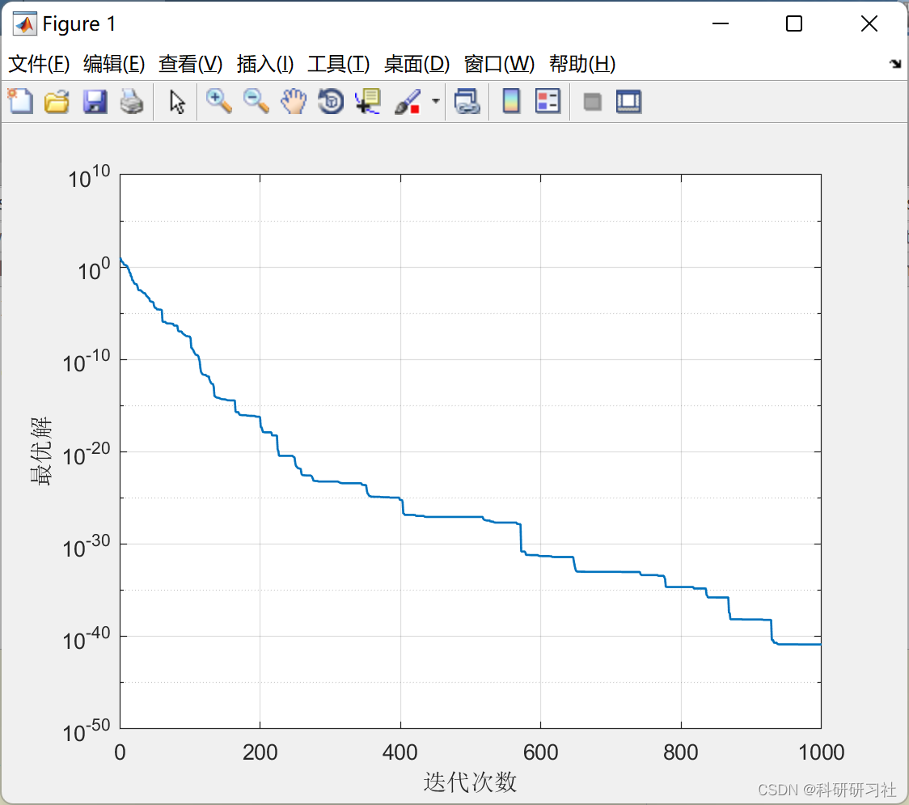

# Imperial Competition Algorithm (ICA) (Matlab Code Implementation)

1. Imperial Competitive Algorithm (ICA)
The Imperial Competitive Algorithm (ICA) was proposed in 2007 and is characterized by its fast convergence speed and strong global search capability. It has been applied to solve the Traveling Salesman Problem (TSP) [12,13]. Zhang Xinlong and others proposed a new type of ICA for solving TSP, where the imperial assimilation adopts a replacement reconstruction method, and the revolutionary process combines an adaptive operator, achieving good optimization effects. Pei Xiaobing and others designed a probability matrix to mine excellent combination blocks from feasible solutions, which can efficiently solve TSP of a certain scale.
The Imperial Competitive Algorithm is an intelligent optimization algorithm based on the political and social evolution phenomena of human society. Each country in the algorithm represents a possible solution space, and during the simulation of social political evolution, it gradually optimizes the solution space of countries to find the optimal solution. The algorithm mainly includes four steps: Imperial Initialization, Imperial Assimilation, Imperial Revolution, and Colony Competition:
a) Imperial Initialization. By randomly generating multiple countries, according to their strength, they are divided into colonial countries and colonies, forming an empire.
b) Imperial Assimilation. The solution information of each colonial country is transferred to its colonies, which gradually approach the colonial country, thereby optimizing the overall solution quality of the empire.
c) Imperial Revolution. This stage simulates historical revolutionary behaviors, with a certain probability that colonies will actively optimize, even surpassing their colonial countries and becoming the empire's colonial country.
d) Colony Competition. This phase is the redistribution process of colonies, with competition mechanisms among empires for colonial territories. In an ideal scenario, only one empire exists, with only one colonial country remaining, at which point the algorithm stops, with the colonial country representing the optimal solution optimized by the algorithm; if there are still multiple countries, it moves to the Imperial Assimilation stage, cycling through updates.
2. Running Results
3. MATLAB Code and Article Explanation - This article only showcases a portion of the code, all code and articles can be found in:
\n\nfunction emp = DoRevolution(emp)\n\n    global ProblemSettings;\n    CostFunction = ProblemSettings.CostFunction;\n    nVar = ProblemSettings.nVar;\n    VarSize = ProblemSettings.VarSize;\n    VarMin = ProblemSettings.VarMin;\n    VarMax = ProblemSettings.VarMax;\n    \n    global ICASettings;\n    pRevolution = ICASettings.pRevolution;\n    mu = ICASettings.mu;\n    \n    nmu = ceil(mu*nVar);\n    \n    sigma = 0.1*(VarMax-VarMin);\n    \n    nEmp = numel(emp);\n    for k = 1:nEmp\n        \n        NewPos = emp(k).Imp.Position + sigma*randn(VarSize);\n        \n        jj = randsample(nVar, nmu)';\n        NewImp = emp(k).Imp;\n        NewImp.Position(jj) = NewPos(jj);\n        NewImp.Cost = CostFunction(NewImp.Position);\n        if NewImp.Cost<emp(k).Imp.Cost\n            emp(k).Imp = NewImp;\n        end\n        \n        for i = 1:emp(k).nCol\n            if rand <= pRevolution\n\n                NewPos = emp(k).Col(i).Position + sigma*randn(VarSize);\n                \n                jj = randsample(nVar, nmu)';\n                emp(k).Col(i).Position(jj) = NewPos(jj);\n\n                emp(k).Col(i).Position = max(emp(k).Col(i).Position, VarMin);\n                emp(k).Col(i).Position = min(emp(k).Col(i).Position, VarMax);\n\n                emp(k).Col(i).Cost = CostFunction(emp(k).Col(i).Position);\n\n            end\n        end\n    end\n\nend\n  
​  

## Images

<!-- PAYMENT_BLOCK -->

## Get this dataset

- Payment link (Stripe): [Buy now](https://buy.stripe.com/3cs8yP7sY87d0vu9AB)
- Payment QR code: 

<!-- /PAYMENT_BLOCK -->
